# 🎮 DotaMod Hub v1.5.0 — Modern Skin Changer & Mod Suite for Dota 2

<p align="center">
  
</p>

<p align="center">
  <b>Автономный скинченджер и менеджер косметических модификаций для Dota 2 с полным каталогом (1 740+ модов).</b><br>
  Установка в 1 клик, безопасное монтирование VPK без риска VAC, кастомизация интерфейса и фонов меню.
</p>

---

## 🌟 Ключевые возможности

- ⚡ **Каталог из 1 743 модов**:
  - Арканы и кастомные сеты (Earthshaker Planetfall, Terrorblade серии Fractal Horns, Kez, Juggernaut Bladeform и сотни других).
  - Эффекты способностей и атаки (Hero FX).
  - Кастомные крипы и анимации добивания (Creep Deny).
  - Озвучки и мега-килл аннонсеры с живым превью звуковых реплик.
  - Погодные эффекты, ландшафты, деревья, шейдеры и шрифты.
- 🖼 **Фоны главного меню**:
  - Поддержка как HD статических артов, так и плавных живых WebM видео-фонов.
  - Полноценная распаковка и применение всех компонентов интерфейса Panorama Dashboard (`dashboard.vxml_c`, стили и скрипты).
- 🛡 **Защита целостности моделек и шейдеров Valve**:
  - Встроенный модуль санитайзера VPK архивов: исключает случайную перезапись системных шейдеров и текстур движка (`materials/default`, `materials/engine`), предотвращая баги с невидимыми героями или красными текстурами Error в игре и арсенале.
- 📦 **Полная автономность**:
  - Все превью и иконки каталога вшиты локально — приложение мгновенно работает даже без подключения к интернету.
- 🚀 **Единый исполняемый файл (Single EXE)**:
  - Сборка в один автономный переносимый файл `DotaModHub-v1.5.0.exe` — не требует предварительной распаковки архивов и установки сторонних зависимостей.

---

## 🚀 Установка и запуск

### Способ 1: Готовый автономный файл (Single EXE)
1. Скачайте **`DotaModHub-v1.5.0.exe`** из раздела [Releases](https://github.com/terbixsorr/DotaModHub/releases).
2. Запустите файл двойным кликом — приложение автоматически распакует свои компоненты и откроет главное окно.
3. Выберите нужные скины или фон меню и нажмите **«Установить мод»**!

### Способ 2: Запуск из исходного кода
Требуется установленный [Node.js](https://nodejs.org/):

```bash
# Клонируйте репозиторий
git clone https://github.com/terbixsorr/DotaModHub.git
cd DotaModHub

# Установите зависимости и запустите
npm start
```

---

## 📂 Структура проекта

```
├── index.html                 # Главный интерфейс приложения (Tailwind CSS, модальные окна, фильтры)
├── style.css                  # Неоновые темные стили и анимации
├── app.js                     # Логика клиента (каталог, фильтры, плеер звуков, фоны)
├── main.js                    # Electron бэкенд (монтирование VPK, санитайзер движка, интеграция с Dota 2)
├── preload.js                 # Безопасный IPC мост между Electron и веб-контекстом
├── data/
│   ├── mods.json              # База данных 1 743 косметических модов
│   ├── mods-data.js           # Офлайн-бандл данных для автономной работы
│   └── dota_heroes_api.json   # База официальных героев Dota 2
├── assets/                    # Локальные ассеты, превью и шрифты
├── audio/                     # Аудиодорожки реплик аннонсеров
├── scripts/
│   └── StandaloneLauncher.cs  # Исходный код C# лаунчера для сборки в Single EXE
└── verify.js                  # Скрипт проверки целостности каталога
```

---

## 🔒 Безопасность и VAC

- Модификации применяются через нативную структуру монтирования ресурсов клиента (`game/dota_russian`), не внедряясь в память процесса `dota2.exe` и не модифицируя исполняемые файлы игры (dll / exe).
- **VAC Safe**: Моды видны только вам на локальном клиенте и не влияют на других игроков.

---

## 📄 Лицензия

Проект распространяется под лицензией MIT.
Все права на оригинальные ресурсы Dota 2 принадлежат Valve Corporation.
