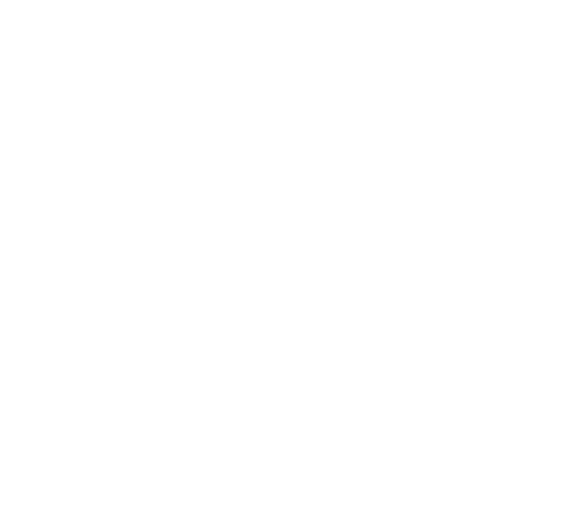

# 🎮 DotaMod Hub v1.6.0 — Source 2 Skin Orchestrator & Asset Management System for Dota 2

<p align="center">
  
</p>

<p align="center">
  <b>Профессиональный модульный менеджер косметических модификаций и скинченджер для Dota 2 (Source 2 Engine).</b><br>
  Единая синхронизированная модель данных (1 886+ скинов), отказоустойчивое монтирование VPK, оффлайн-кэш ассетов и безопасная интеграция без модификации бинарных файлов игры.
</p>

<p align="center">
  
  
  
  
  
  
</p>

---

## 📌 Архитектурные принципы и ключевые возможности

DotaMod Hub спроектирован как высокопроизводительное, надёжное десктопное приложение для управления локальными модификациями Dota 2. Архитектура исключает рассинхронизацию интерфейса и файловой системы:

### 1. Единый источник истины (`SkinCatalog`)
- **Zero-Desync Architecture**: Каталог, карточки, поиск, категории, избранное, окно детального просмотра и лайтбокс обращаются к строго типизированному объекту `SkinCatalog`.
- **Гарантированная целостность**: Исключены устаревшие раздельные массивы имён и картинок по индексам. Каждому скину принадлежит уникальный ID, проверенное локальное превью, категория, редкость и ссылка на файл.
- **Интеллектуальная система алиасов (`CATALOG_ALIASES`)**: При удалении дубликатов или обновлении структуры каталога сохранённые пользователем моды в «Избранном» автоматически связываются с каноническим объектом.

### 2. Отказоустойчивое файловое ядро (EBUSY Resilience)
- **Безопасная замена файлов на лету**: В операционной системе Windows файлы VPK могут временно блокироваться индексатором поиска, антивирусом или игрой. Функция `safeReplaceFile` использует циклы повторных попыток (backoff retry) и побитовое перезаписывание `copyFileSync` без преждевременного `unlink`.
- **Динамическое выделение архивов (`pakXX`)**: Если конкретный VPK-файл удерживается запущенным процессом, установщик автоматически выделяет следующий свободный номер (`pak100` и далее), не прерывая установку ошибкой.

### 3. Санитайзер VPK архивов (Engine Shader Guard)
- **Защита системных шейдеров Valve**: Парсер бинарного дерева VPK автоматически анализирует и отсекает системные пути движка (`materials/default`, `materials/engine`), предотвращая появление критических артефактов (красные текстуры Error, битые шейдеры героев, невидимые модельки).

### 4. Неинвазивная VAC-совместимая интеграция
- **Без инъекций в память (Zero Injection)**: Приложение не внедряет DLL, не перехватывает системные вызовы и не считывает память процесса `dota2.exe`.
- **Нативное монтирование**: Модификации размещаются исключительно в выделенном оверлейном каталоге клиента (`game/dota_russian`), а оригинальный файл конфигурации `game/dota/gameinfo.gi` остаётся полностью неизменным.

### 5. Оффлайн-first и локальный кэш
- **100% автономность**: Все 1 886 превью-изображений формата WebP и иконки героев хранятся локально в директории `assets/previews/`. Интерфейс загружается мгновенно без сетевых задержек.

---

## 📊 Структура каталога модификаций (1 886 предметов)

| Категория | Количество | Описание |
| :--- | :---: | :--- |
| **Герои и арканы (`heroes`)** | **857** | Полные скины, эксклюзивные арканы, кастомные ремодели и персонажи |
| **Косметические сеты (`sets`)** | **223** | Коллекционные турнирные и кастомные наборы брони |
| **Эффекты способностей (`herofx`)** | **141** | Кастомные частицы скиллов, эффекты атак и ауры |
| **Предметы героев (`hero-items`)** | **105** | Одиночные Immortal-оружия, шлемы, плечи и аксессуары |
| **Фоны главного меню (`backgrounds`)** | **101** | Динамические WebM-панорамы и статичные HD-арты для дашборда |
| **Озвучки и звуки (`hero-sounds`, `sounds`)** | **88** | Кастомные звуковые пакеты, замена озвучек ультов и реплик |
| **Мега-киллы и анонсеры (`mega-kill`)** | **49** | Звуковые дорожки комментаторов и стриков убийств с плеером |
| **Шейдеры и рендер (`shaders`)** | **32** | Пост-процессинг, цветокоррекция, освещение и контраст |
| **Курьеры (`couriers`)** | **30** | Кастомные модели и эффекты курьеров |
| **Интерфейсы HUD (`huds`)** | **27** | Оформление внутриигрового интерфейса, панелей здоровья и скиллов |
| **Крипы и добивания (`creeps`, `creep-deny`)** | **37** | Скины крипов Света/Тьмы и визуальные эффекты добивания |
| **Окружение (`terrains`, `trees`, `river`)** | **58** | Ландшафты, деревья, сезонные реки и погодные эффекты |
| **Варды, курсоры, пинги, эмблемы** | **148** | Прочая косметика, шрифты, экраны противостояния и значки |

---

## 🛠 Технологический стек

- **Core**: Node.js, Electron 28, Native Windows FileSystem APIs
- **Interface**: HTML5, Tailwind CSS, Glassmorphism UI (Dark Obsidian palette `#080b11`), FontAwesome Pro
- **Parsing & Binary Engine**: Встроенный парсер заголовков Source 2 VPK (Magic `0x55aa1234`), алгоритмы распаковки ZIP/TAR, WebM stream extractor

---

## 🚀 Установка и запуск

### Вариант 1. Скомпилированная версия
1. Запустите исполняемый файл приложения `DotaModHub.exe` (или ярлык на рабочем столе).
2. При первом запуске укажите путь к корневой папке игры (обычно `C:\Program Files (x86)\Steam\steamapps\common\dota 2 beta`).
3. Выберите желаемый скин или эффект в каталоге и нажмите **«Скачать»** / **«Установить»**.

### Вариант 2. Запуск из исходного кода
```bash
# Клонирование репозитория
git clone https://github.com/terbixsorr/DotaModHub.git
cd DotaModHub

# Установка зависимостей
npm install

# Запуск в режиме разработки
npm start

# Сборка дистрибутива
npm run build
```

---

## 🔒 Безопасность и VAC Compliance

```
[Dota 2 Client Engine]
         │
         ├── game/dota (100% оригинальные системные файлы Valve, gameinfo.gi чист) ──> [VAC Verification PASS]
         │
         └── game/dota_russian (Оверлей ресурсов pakXX_dir.vpk) ───────────────────> [Локальный рендер модов]
```

1. **Не затрагивает защищённую директорию `game/dota`**: Все системные файлы игры сохраняют оригинальные контрольные суммы Valve.
2. **Абсолютная изоляция процесса**: Приложение работает вне адресного пространства игры и не использует инжекты или системные хуки.
3. **Функция восстановления («Очистка VAC»)**: В настройках приложения доступно мгновенное восстановление абсолютно чистого состояния клиента Dota 2 в один клик.

---

## 📜 Журнал версий (Changelog v1.6.0)

- **v1.6.0**:
  - Каталог расширен до **1 886 предметов** (+215 новых скинов и сетов из мастерской сообщества).
  - Внедрена отказоустойчивая система разрешения блокировок файлов Windows (`EBUSY` Resilience).
  - Исправлена установка модов напрямую из модального окна «Избранное» с корректной синхронизацией состояния кнопок в DOM.
  - Устранены дублирующиеся pak-номера в манифесте установленных модов.
  - Добавлена полная автономная загрузка 187 новых превью высокой чёткости в WebP.
  - Обновлён UI/UX интерфейса согласно дизайн-системе Dark Obsidian & Glassmorphism.

---

## 📄 Лицензия

Распространяется под лицензией **MIT**.  
Dota 2, Source 2, логотипы и изображения являются зарегистрированными торговыми марками Valve Corporation. Все права защищены.
